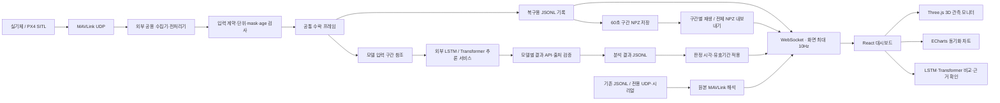

# ARION · 드론 비행 모니터링 대시보드

배터리와 모터 1~4의 관측값, 3D 자세·위치·궤적, LSTM·Transformer의 이상 판단을 확인하는 연구·시연용 웹 대시보드입니다. 기본 환경은 단일 기체, 한국어 화면, 데스크톱 브라우저와 로컬 실행입니다.

**현재 공개된 범위는 1~3단계입니다.** 로그·실시간 모니터링 기반과 서버 실행 도구에 균형형 레이아웃·모델 비교·업로드 재시도를 추가했습니다. 파일 저장 전환과 NPZ 보관·재생은 후속 단계입니다.

## 역할과 범위

| 담당 | 역할 |
| --- | --- |
| 대시보드 | 입력 검사, 로그 재생·실시간 표시, 모델 결과 연결, 근거 확인 |
| 공용 수집기·전처리기 | MAVLink 수신, 물리 단위 변환과 전처리 결과 생성 |
| AI팀 | 모델 입력·scaler·학습·추론·임계값·경보 정책·성능 평가 |
| 시뮬레이션 담당 | 고정 버전·커스텀 소스·실행 방법·기준 원본 로그 제공 |

QGroundControl은 일반 비행상태 확인과 조종을 담당합니다. 대시보드는 관측과 AI 결과를 표시하며, 고장 원인을 확정하거나 기체에 제어 명령을 보내지 않습니다. 학습, 물리 시뮬레이션, 건강도 %, 잔여수명과 자동 정비 권고는 대시보드 범위에 포함하지 않습니다.

## 최종 목표 설계도

외부 공용 전처리기에서 받은 **같은 프레임을 실시간 화면과 NPZ 보관에 함께 사용**하는 구조를 목표로 합니다. 최종 구조는 별도 DB 없이 JSON·JSONL·NPZ 파일로 저장합니다.



이 설계도는 **최종 목표**입니다. 1단계 코드의 비행 목록·설정·분석 결과 저장에는 SQLite를 사용합니다. 파일 저장으로 전환하는 단계에서 기존 DB와 원본을 보존하고 비행 ID를 유지하며 이관할 예정입니다.

### 목표 데이터 계약

| 객체 | 주요 정보 |
| --- | --- |
| `InputProfile` | 특징 이름·순서·단위, 지원 신호, 출력 주기, 만료 기준과 표시 매핑 |
| `SourceSession` | 재생/실시간 구분, 입력 종류·프로필, 연결·수집 상태 |
| `ProcessedFrame` | 세션·순서·epoch, 원본 ns 시각·상대 시각, 물리값·mask·유효성·관측 나이·전처리 버전 |
| `RunManifest` | 비행 ID·출처·계약 스냅샷·입력 해시·저장 구간·검사 결과 |
| `AnalysisResult` | 제공자·모델 버전, 입력 참조, 근거 구간·판정 시각, 상태·점수·임계값·근거 |

- 특징 19개나 특정 배터리 구성을 새 입력의 고정 전제로 사용하지 않습니다. 단위·특징·주기가 바뀌면 새 프로필과 계약 버전으로 구분합니다.
- 원본 수신률, 전처리 출력률, 모델 추론 주기, 결과 API 확인 주기와 화면 갱신률을 각각 관리합니다. 10Hz 전처리를 모든 센서의 수신률로 간주하지 않습니다.
- 이미 전처리된 입력은 다시 전처리하거나 scaler를 적용하지 않습니다. 물리값·mask·관측 나이를 보존하고 실제 0과 결측을 구분합니다.
- 재생 결과는 파일 해시로 확인합니다. 진행 중인 비행은 세션·epoch·순서 구간·구간 해시·전처리 버전으로 검증합니다.
- 모델별 점수와 임계값을 분리합니다. 같은 비행과 근거 구간에서 비교하며 점수를 평균하거나 건강도·고장 확률로 바꾸지 않습니다.

### 목표 파일 보관

전처리 프레임은 복구용 JSONL에 먼저 기록하고 60초 구간 NPZ로 저장합니다. 종료·epoch 변경에서도 구간을 마감하며, 종료 후 전체 비행 NPZ를 내보냅니다. 저장 실패는 상태로 표시하고 저널에서 재시도·복구합니다.

NPZ는 물리값 `X[N,F]`, `mask/status/age_ns[N,F]`, `tick_ns/source_time_ns/sequence/epoch[N]`와 특징·단위·순서·전처리 버전을 포함한 JSON metadata를 담습니다. 결측은 실제 0으로 채우지 않습니다. 메모리는 최근 표시 구간으로 제한하고 전체 기록은 디스크에 보관하는 방향입니다.

기존 학습용 NPZ 검사는 개발용으로 유지합니다. 데이터 준비 상태를 AI 정상 판정으로 사용하지 않으며, 원본 해시가 다른 NPZ와 JSONL을 동일 비행의 변환 결과로 자동 결합하지 않습니다.

## 화면 설계

핵심 흐름은 **비행 선택 → 재생 또는 실시간 관측 → 이상 구간 발견 → 시점 선택 → 관련 신호와 판단 근거 확인**입니다.

| 화면 | 주요 구성 |
| --- | --- |
| 비행 모니터링 | 출처·연결·재생 상태, 배터리·모터 관측, 3D, 동기화 차트, 모델별 상태 |
| 이상 구간 분석 | 제공자 필터, LSTM·Transformer 결과, 근거 구간·관련 신호·예측·잔차 |
| 데이터 진단 | 수신 주기, 결측·만료·누락·오류 행, 입력 계약과 모델 호환성 |

현재 화면은 **왼쪽 3D / 오른쪽 두 모델 비교**, 아래에 관측 요약·차트·모터·궤적·이벤트를 배치합니다. 작은 화면에서는 패널을 세로로 표시합니다.

### 균형형 워크스페이스 사용법

- 모델 카드에서 상태·점수·임계값·근거 구간을 확인하고 화살표로 판정 근거를 엽니다.
- 비교 요약은 비행·입력 참조·epoch·대상·근거 구간이 같은 유효 판정만 일치/불일치로 표시합니다. 다른 구간은 개별 확인하도록 안내합니다.
- 3D는 수신한 위치·자세를 표시하며 회전·확대·기체 따라가기와 시점 초기화를 지원합니다.
- 서버 연결 상태는 자동으로 확인하고, 오프라인에서 실행 안내와 **연결 다시 확인** 버튼을 제공합니다.
- 업로드 중 연결이 끊기면 선택한 파일을 페이지 메모리에 유지하고 **가져오기 다시 시도**를 제공합니다. 새로고침하면 파일 선택은 다시 해야 합니다.
- 가져오기 성공은 반환된 manifest로 반영합니다. 마지막 선택 비행을 기억하고, 비행 정보를 확인한 뒤 재생 연결을 시작합니다.

### 표시 원칙

- AI 미연결·준비 중·판정 불가·연결 끊김을 정상과 구분합니다.
- 결측은 `—`, 유효한 0은 `0`으로 표시합니다. 긴 공백과 epoch 경계를 차트 선으로 연결하지 않습니다.
- SOC는 충전 잔량입니다. SOH·건강도와 구분하고 고정 온도를 열 이상 근거로 사용하지 않습니다.
- 모터는 슬롯 1~4로 표시합니다. 실제 장착 위치가 확인되기 전에는 특정 날개와 연결하지 않습니다.
- 3D는 수신된 위치·자세·궤적만 표시합니다. NED를 화면의 동·위·남 축으로 변환하며, 미수신·만료 시 마지막 상태를 흐리게 표시합니다. 움직임을 예측하거나 없는 GPS 좌표를 만들지 않습니다.
- 예측값·잔차는 모델 API가 제공한 경우에만 표시합니다. 모든 이벤트와 관측은 같은 시간축을 사용하며 되감기하면 미래 판정은 숨깁니다.
- 합성 관측과 시험용 AI 응답은 명시적으로 표시합니다. 화면 동작 검증과 실제 AI 정확도 검증을 구분합니다.

## 기술 스택

| 영역 | 사용 기술 |
| --- | --- |
| 화면 | React · TypeScript · Vite |
| 시계열·궤적 차트 | Apache ECharts |
| 3D 모니터 | Three.js · OrbitControls |
| 로컬 서버 | Python · FastAPI · WebSocket |
| MAVLink 수신 | Pymavlink · PySerial |
| 1단계 저장 | SQLite 메타데이터·분석 결과 + 원본·세션 JSONL |
| 최종 목표 저장 | JSON 설정·manifest, JSONL 원본·분석 결과, NPZ 구간 파일 |

## 1단계에서 구현한 기능

- MAVLink JSONL 가져오기·검사·재생, 원본 해시와 오류 행 진단.
- 재생·일시정지·배속·시점 이동, 최대 10Hz WebSocket 화면 갱신.
- 전용 UDP·시리얼의 수신 전용 실시간 모니터링과 세션 JSONL 기록.
- 기존 `arion-normalized-v2` 전처리 프레임 API, 불변 입력 프로필과 호환성 검사.
- 관측 기반 3D와 동기화 차트, 번호별 모터 카드·로컬 궤적.
- LSTM·Transformer의 독립적인 로컬 HTTP 결과 API 연결, 입력 참조·시각·epoch 검증.
- 화면 일시정지 중 수신·기록 유지와 실시간 복귀, 종료 후 같은 세션 재생.

실제 모델 코드·가중치와 외부 공용 전처리기는 포함하지 않습니다. UI 연동 확인용 시험 송신기와 시험 결과 API를 제공합니다.

## 개발 단계

| 단계 | 내용 | 이 커밋 기준 상태 |
| --- | --- | --- |
| 1 | 로그 재생·실시간 수신·3D·두 모델 연결 기반 | 구현 |
| 2 | 백그라운드 서버 유지와 API 연결 오류 처리 | 구현 |
| 3 | 균형형 워크스페이스·모델 비교·업로드 재시도 | 구현 |
| 4 | 공통 전처리 프레임·파일 저장 전환·NPZ 보관/재생 | 후속 |
| 5 | 최종 계약·구조도·사용법·통합 검증 문서 정리 | 후속 |

## 저장소 구성

| 경로 | 역할 |
| --- | --- |
| `frontend/` | React 화면·차트·3D·재생 제어 |
| `backend/arion/` | 입력 해석·세션 기록·결과 API·WebSocket |
| `backend/tests/` | 입력·시간·수신·분석 연동 테스트 |
| `docs/` | 데이터 사전·계약·스키마·검증 기록 |
| `.github/` | 기존 협업용 Issue·PR 템플릿 |

## 실행

Mac에서 Python 3.11 이상과 Node.js 22.12 이상을 준비합니다.

```bash
git clone https://github.com/capstone1-irion/ui.git
cd ui
./setup.sh
./server.sh start
```

브라우저에서 [로컬 대시보드](http://127.0.0.1:8765/)를 엽니다. `./server.sh start`는 서버를 백그라운드에서 유지하므로 실행한 터미널을 닫아도 연결을 사용할 수 있습니다. 상태 확인은 `./server.sh status`, 종료는 `./server.sh stop`입니다. 기존 `./start.sh`는 터미널을 유지하는 전경 실행이며 Ctrl+C로 종료합니다.

서버는 `127.0.0.1`에만 바인딩합니다. 이미 사용 중인 포트를 자동으로 변경하지 않습니다. 종료 시 저장된 PID와 서버가 응답한 실행 식별자가 일치하는 경우에만 해당 프로세스를 종료합니다. 원본 로그·학습 데이터는 저장소에 포함하지 않으며, 사용자가 직접 JSONL을 가져옵니다.

### API 연결 오류 처리

- 연결 실패: `Failed to fetch` 대신 로컬 서버를 실행하도록 한국어로 안내합니다.
- HTTP 오류: 입력 검사 실패·서버 오류의 상태 코드와 원래 상세 메시지를 유지합니다.
- 응답 형식 오류: JSON이 아닌 응답은 연결 실패와 구분합니다.
- 업로드: multipart 경계를 브라우저에 맡기며 한글 파일명을 유지합니다. 실패한 업로드를 자동으로 재전송하지 않습니다.

화면은 이미 받아온 상태가 남아 있어도 서버가 종료되면 가져오기·재생 요청을 처리할 수 없습니다. `./server.sh start` 후 자동 연결 확인을 기다리거나 **연결 다시 확인**을 누르세요. 가져오기 대기 파일이 있으면 **가져오기 다시 시도**로 재전송합니다.

실시간 연결 기본값은 UDP `127.0.0.1:14560`입니다. QGC나 기존 수집기가 사용하는 포트와 공유하지 않습니다. 시리얼은 사용자가 장치와 baud rate를 지정합니다. heartbeat·비행 제어·stream 변경 명령은 송신하지 않습니다.

### 시뮬레이터 없이 시험

화면에서 이름에 `시험`을 포함한 UDP 세션을 생성하고 별도 터미널에서 실행합니다.

```bash
cd ui/backend
../.venv/bin/python -m arion.test_sender --seconds 45
```

기본 10Hz 전처리 입력은 화면에서 `normalized_flight_v1` 세션을 만든 뒤 아래 명령에 반환된 ID를 넣습니다.

```bash
../.venv/bin/python -m arion.test_sender --normalized-session live-발급된ID --seconds 45
```

두 모델 연결 화면을 검증하려면 시험 API를 별도로 실행합니다.

```bash
../.venv/bin/python -m uvicorn arion.mock_ai:app --host 127.0.0.1 --port 8766
```

- LSTM: `http://127.0.0.1:8766/lstm/results`
- Transformer: `http://127.0.0.1:8766/transformer/results`

이 API의 결과는 인공 응답이며 실제 고장이나 모델 탐지를 의미하지 않습니다. 실제 추론 서비스는 AI팀 인계 후 같은 결과 계약으로 연결합니다.

## 검증과 문서

```bash
./test.sh
```

이 단계의 백엔드 테스트 60개, 프런트엔드 테스트 17개와 TypeScript/Vite 빌드를 확인했습니다. 모델 비교의 일치·불일치·다른 입력 구간·판정 불가를 테스트하고, 화면과 업로드 복구를 브라우저에서 검증했습니다.

검증 대상은 단위·미지원값·실제 0, 시간·epoch, 재생의 인과성, 전용 UDP·가상 시리얼 수신, 모델별 오류 분리와 입력 출처 검증입니다. 실제 모델 정확도·실기체 비행과 커스텀 SITL 전체 연동은 별도 검증이 필요합니다.

- [입력·분석 계약 v2](docs/v2-contracts.md)
- [데이터 사전](docs/data-dictionary.md)
- [AI 결과 계약](docs/ai-contract.md)
- [기반 구현 검증 기록](docs/validation-v2.md)
- [균형형 화면·업로드 검증 기록](docs/validation-balanced.md)
- 실행 중 API 문서: `http://127.0.0.1:8765/docs`

`.data`, 원본 JSONL·NPZ, 모델 가중치, 가상환경, 의존성, 빌드 결과와 로컬 비밀정보는 Git에서 제외합니다. 개발은 단일 서버 worker를 기준으로 합니다.
