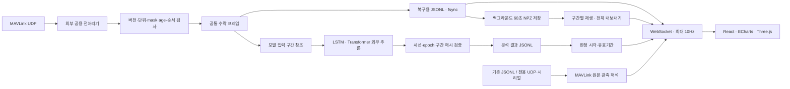

# 아리온 대시보드 v0.4 구조

균형형 워크스페이스에서 왼쪽 3D와 오른쪽 LSTM·Transformer를 같은 시간축으로 봅니다. 전처리 스트림에는 저장 상태 바가 추가되며 기존 배터리·모터·궤적·이상 상세·데이터 진단은 유지합니다. 학습과 물리 시뮬레이션·비행 제어는 외부에서 수행합니다.

실시간과 재생은 관측값과 모델 판정을 구분합니다. 화면 일시정지는 수신·기록을 멈추지 않으며, 입력 만료에서는 자세를 예측하지 않습니다. 되감기하면 미래 판정이 사라집니다. 서로 다른 모델 점수는 평균하지 않습니다.

저장은 로컬 JSON·JSONL·NPZ 파일입니다. 기존 SQLite는 최초 이관 시 읽기 전용으로 열어 백업하며 이후에는 사용하지 않습니다. 원본 파일과 비행 ID를 유지합니다. 단일 서버 worker로 실행합니다.

완료된 전처리 기록은 NPZ 두 구간 캐시로 재생하고, 차트는 현재 시점 주변 5분을 읽습니다. 전체 NPZ 내보내기는 디스크 memmap과 ZIP 스트리밍을 사용합니다. 기존 MAVLink JSONL 재생은 현재 파서를 유지합니다.

입력 예시·저장 규격·추가 API는 [전처리·NPZ 계약](processed-npz-contract.md), 모델 결과와 기존 입력은 [v2 계약](v2-contracts.md), 사용법은 [README](../README.md), 검증 결과는 [v3 검증 기록](validation-v3.md)을 참고하세요. API 문서는 로컬 `/docs`에서 제공합니다.

이전 발표용 이미지와 생성 프롬프트는 [설계 자산·문서 안내](design-assets.md)에 보관합니다. 해당 이미지는 실시간 전처리·NPZ 보관 경로가 추가되기 전의 설계 이력이며, 현재 구현은 위 구조도를 기준으로 합니다.
