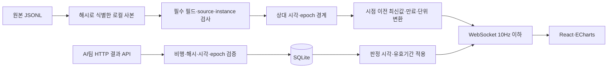

> 이 문서는 v0.1 기록입니다. 현재 기능과 계약은 [v2 계약](v2-contracts.md), 검증은 [v2 검증 기록](validation-v2.md)을 참조하세요.

# 화면과 데이터 흐름

## 화면 와이어프레임

```text
┌──────────────┬───────────────────────────────────────────┐
│ ARION        │ 비행 모니터링             로그 가져오기   │
│              │ 비행 선택 / 출처 / 길이 / 관측 건수       │
│ 비행 모니터링├────────────┬───────────┬──────────────────┤
│ 이상 구간    │ 배터리     │ 비행 상태 │ AI 연결·판정     │
│ 데이터 진단  ├────────────┴───────────┴──────────────────┤
│              │ 모터 1      모터 2      모터 3     모터 4 │
│ 로그 재생    ├──────────────────────┬───────────────────┤
│ 실시간: 후속 │ 배터리 시계열        │ 모터 RPM 시계열   │
│              ├──────────────────────┼───────────────────┤
│              │ 로컬 동·북 궤적      │ 판정 이력         │
├──────────────┼──────────────────────┴───────────────────┤
│              │ 재생 / 배속 / 타임라인 / 오류 행 진단    │
└──────────────┴──────────────────────────────────────────┘
```

이상 구간 화면은 판정 목록과 상세 근거 패널로 나뉩니다. 이벤트 선택은 pause + seek(decided_at_ms)이며 원인 확정을 하지 않습니다. 데이터 진단 화면은 메시지별 관측 나이, 필드별 유효성, 원본 검사, NPZ 검사, API 연결·지연 측정을 제공합니다. 좁은 창에는 상단 세 화면 메뉴를 제공합니다.

## 구현 흐름



브라우저마다 재생 세션을 독립적으로 유지합니다. play/pause/seek/speed는 WebSocket 제어 메시지이며 비행제어 명령이 아닙니다. 매 틱마다 cursor 이전의 관측만 사용합니다. 빠른 되감기 후에도 미래 값이나 결과가 남지 않도록 서버가 전체 스냅샷을 제공합니다.

시계열 차트는 기본 100ms grid의 표시용 집계입니다. 1만 개를 초과하면 표시 간격을 늘리며 원본은 그대로 보존합니다. 모델 입력·학습 특징을 생성하는 전처리가 아닙니다. 차트는 결측·만료 구간을 null로 두고 epoch 앞에 null 분리점을 넣습니다.

## API

| 경로 | 역할 |
|---|---|
| `GET /api/health` | 서버 상태, 실시간 기능 미지원 명시 |
| `GET /api/runs` | 비행 목록과 RunManifest |
| `POST /api/runs/import` | multipart JSONL 업로드, 최대 64MiB |
| `GET /api/runs/{id}` | 상세 RunManifest |
| `GET /api/runs/{id}/frame?t_ms=...` | 특정 시점 TelemetryFrame |
| `GET /api/runs/{id}/series` | 표시용 시계열; 브라우저가 cursor까지 제한 |
| `WS /api/ws/runs/{id}` | 재생 제어·최대 10Hz 스냅샷 |
| `POST /api/runs/{id}/npz` | multipart NPZ 검사; pickle 금지 |
| `GET /api/runs/{id}/diagnostics` | 원본·NPZ 진단 |
| `GET /api/runs/{id}/inspection.json` | 검사 결과 다운로드 |
| `POST /api/runs/{id}/demo` | `{ "enabled": true/false }`, 명시적 시험 표시 |
| `POST /api/runs/{id}/ai/connect` | `{ "url": "http://127.0.0.1:8766/results" }` |
| `POST /api/runs/{id}/ai/disconnect` | API 폴링 종료 |
| `GET /api/metrics` | 화면 반영 확인 표본·p95 |

HTTP API의 OpenAPI는 `/docs`, JSON 스키마는 `/openapi.json`에서 확인할 수 있습니다. UI 타입은 `frontend/src/types.ts`, AI 계약의 검증 타입은 `backend/arion/schemas.py`가 소유합니다.

## 후속 SITL 연결

공용 수집기 소스 확보 → 고정 버전·Mac 빌드 확인 → 원본 9종 수신 확인 → 기존 단독 수신기 뒤 전달 계층 추가 → 동일 `TelemetryFrame` 생성·WS 전송 → 원본과 화면 대조 순서입니다. 별도 수신기를 같은 UDP 포트에 bind하지 않습니다. 1초 주기 latest 조회를 원본 이벤트 스트림으로 대체하지 않습니다. 현 저장소의 PX4에 이 변경을 적용하지 않았습니다.
