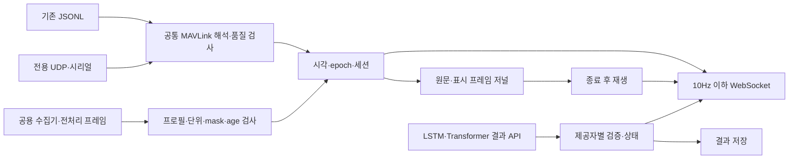

# 입력·분석 계약 v2

구현의 검증 가능한 스키마는 `input-profile.schema.json`, `normalized-input.schema.json`, `analysis-response-v2.schema.json` 및 로컬 `/openapi.json`입니다. 기존 `ai-contract.md`의 v1 경로는 호환용이며 신규 제공자는 v2를 사용합니다.

## 데이터 흐름



원본 센서 수신률, 전처리 출력 주기, 모델 추론 주기, API 폴링 주기, 브라우저 갱신률을 혼용하지 않습니다. 10Hz 입력은 100ms grid를 생산자가 이미 만든 경우이며 대시보드는 추가 보간·scaler·학습 처리를 하지 않습니다.

## 입력 프로필과 수집 세션

- `GET /api/profiles`, `POST /api/profiles`: 불변 `profile_id`로 등록. 주기·단위·전처리 버전 변경은 새 ID/세션을 사용합니다.
- `POST /api/sessions`: `SourceConfig`로 생성과 연결. 실패해도 오류 상태가 있는 세션을 반환해 UI에서 재연결할 수 있습니다.
- `POST /api/sessions/{id}/connect`, `/disconnect`, `/finish`: 수신 재연결·해제·기록 종료.
- `POST /api/sessions/{id}/frames`: normalized 세션에만 프레임 입력.
- `GET /api/runs/{id}/input-segment?start_sequence=1&end_sequence=20`: 검증용 입력 참조와 실제 프레임 조회.

UDP 기본 요청:

```json
{"name":"전용 링크 비행","kind":"udp","profile_id":"mavlink_common_v1","host":"127.0.0.1","port":14560,"source_system":null,"source_component":null}
```

시리얼은 `kind=serial`, 명시적 `/dev/` 장치와 baud를 추가합니다. 원격 UDP는 로컬 전용 링크에 전달합니다. 소켓 재사용 옵션을 켜지 않으며 heartbeat·파라미터·명령을 송신하지 않습니다. UI에서 수집을 재연결하면 다음 관측이 새 epoch가 됩니다.

전처리 프레임 예시:

```json
{
  "schema_version":"arion-normalized-v2",
  "session_id":"live-실제세션ID",
  "sequence":1,
  "epoch":0,
  "source_time_ns":10000000000000123,
  "preprocess_version":"normalized-v1",
  "sample_period_ms":100,
  "values":{
    "battery_current_a":{"value":0,"unit":"A","valid":true,"age_ms":0},
    "battery_soc_pct":{"value":82,"unit":"%","valid":true,"age_ms":80}
  }
}
```

`source_time_ns`는 생산자 내 단조 시각의 정수 ns입니다. 브라우저로 전달하는 재생 좌표는 상대 ms입니다. 동일 producer epoch의 중복·역전 sequence는 거부합니다. 새로운 producer epoch, 시계 역행 또는 프로필의 gap 초과는 로컬 epoch를 구분합니다. 빠진 sequence는 진단에 누적합니다.

필드가 없으면 missing, `valid=false`면 invalid, age가 TTL을 초과하면 stale입니다. `0`은 결측이 아닙니다. 오래된 관측을 10Hz로 반복 전달하면 age도 그만큼 증가시켜야 합니다. 선언되지 않은 신호·잘못된 단위·변경된 전처리 버전/주기는 422로 거부하고 저널에 사유를 보존합니다. 알려진 표시 신호 이름의 SI 단위는 고정이며 생산자가 변환합니다. 새로운 이름의 신호는 프로필에 등록하여 진단 화면에서 확인할 수 있습니다.

MAVLink 프로필은 지원된 디코더의 신호와 메시지에 연결합니다. `voltage_encoding`은 `mavlink`(유효 셀/팩 항목 합산) 또는 `arion_4s`, `missing_current_raw`는 생산자별 raw sentinel 목록입니다. 표준 MAVLink의 음수 전류를 임의로 미지원으로 바꾸지 않습니다.

## 분석 제공자

- `GET/POST /api/analysis/providers`: 제공자 목록·등록.
- `POST /api/runs/{run}/analysis/{provider}/connect`: `{"url":"http://127.0.0.1:8766/lstm/results"}`.
- `POST /api/runs/{run}/analysis/{provider}/disconnect`: 제공자 하나만 해제.
- `POST /api/runs/{run}/analysis-demo`: 기존 로그에서만 명시적 시험 결과 활성화.

초기 제공자 ID는 `lstm`, `transformer`입니다. 이름·모델 버전·결과 종류·입력 요구사항을 등록할 수 있습니다. `requirements`에는 필요한 `signals`(이름→단위), `sample_period_ms`, `preprocess_version`을 선언합니다. `model_version=unconfigured`는 버전을 아직 고정하지 않았다는 뜻이며 실제 모델 준비가 완료됐다는 뜻이 아닙니다.

현재 HTTP 어댑터는 로컬 주소만 허용하고 500ms마다 GET합니다. `run_id`, `provider_id`, `input_sha256`, `latest_sequence`를 전달합니다. 원본 파일 자체를 자동 전송하지 않습니다. 한 응답의 모든 결과를 검증한 뒤 원자적으로 저장하며 오류는 해당 제공자에만 적용합니다.

응답 골격:

```json
{
  "schema_version":"arion-provider-results-v2",
  "provider_id":"lstm",
  "run_id":"run-실제ID",
  "state":"ready",
  "results":[]
}
```

개별 결과는 `provider_id`, `run_id`, `event_id`, `model_version`, `kind`, `origin`, `input_ref`, `epoch`, `start_ms`, `end_ms`, `decided_at_ms`, `valid_until_ms`, `status`, `target`, `title`을 포함합니다. `start ≤ end ≤ decided_at ≤ valid_until`이며 근거·판정은 해당 epoch와 현재 알려진 시간 범위를 벗어날 수 없습니다. 진행 중 세션은 유효 종료만 미래일 수 있습니다. 시점 이동 시 판정 시각 이전 결과는 숨겨집니다.

- 파일 입력: `input_ref={"kind":"file","sha256":"최종 원본 해시"}`.
- 실시간 입력: `kind=stream`, `session_id`, `start_sequence`, `end_sequence`, `segment_sha256`, `preprocess_version`.
- 구간 해시는 해당 sequence의 정규화된 **표시 프레임 객체**를 정렬 키·UTF-8·공백 없는 JSON으로 인코딩하고, 개행으로 연결한 바이트의 SHA-256입니다. `input-segment` 응답의 참조를 사용하면 인코딩 차이를 피할 수 있습니다. 다른 세션·구간·전처리 결과를 결합하지 않습니다.
- detector의 정상/이상 의심에는 모델 고유 score·threshold가 필요합니다. 서로 다른 모델의 점수를 평균하지 않습니다. 제공자가 필수로 선언한 신호의 실제 값이 결측·만료이면 수치 판정을 거부합니다.
- explanation은 `status=explanation`, score·threshold 없음, 근거 신호 또는 관련 이벤트 참조가 필요합니다. 설명을 정상/이상 판정으로 사용하지 않습니다. 현재 외부 LLM 호출은 없습니다.
- `origin=fixture`는 모든 화면에서 시험용으로 표시합니다. 실제 모델은 `origin=model`을 명시합니다.

## 저장·시간·메모리

기존 파일 해시 기반 run ID는 유지됩니다. 새 실시간 run ID는 세션 UUID 기반이며 종료 후에도 유지됩니다. 종료 시 저널 전체 해시를 별도 확정합니다. SQLite v2 테이블은 기존 `detections`를 삭제하지 않고 `legacy` 제공자로 복사합니다.

실시간 저널에는 시작 프로필·설정, 수신 원문, causal 표시 프레임, 오류 행이 저장됩니다. raw ns와 바이너리 보조 필드는 보존합니다. 바이너리는 `$bytes` hex, 비유한 숫자는 `$float`로 표기합니다. 활성 입력 버퍼는 최근 5분/최대 60,000개 관측이고 화면은 100ms 표시 간격을 사용합니다. 이전 기록은 파일에 남으며 종료 후 재생합니다. 현재 저널 재생은 파일을 메모리에 읽으므로 장시간 대용량 비행은 분할 수집을 권장합니다.

3D는 NED `(north,east,down)`을 `(east,-down,-north)`로 변환합니다. 자세는 FRD→NED의 yaw/pitch/roll 회전을 장면 좌표계로 변환합니다. 재생에서는 미래 자세를 참조하지 않고, 만료 상태에서 외삽하지 않습니다. 카메라 조작·렌더링만 별도 30fps 루프이며 센서 값의 30Hz 수신을 뜻하지 않습니다.
